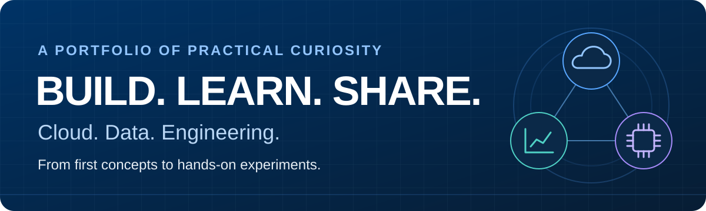
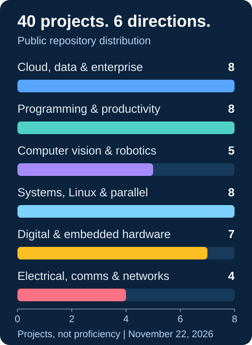
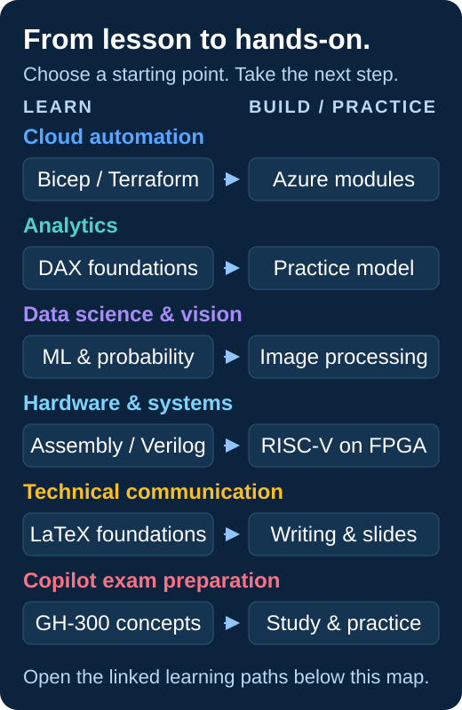

  

  
  <h1>Timna Brown</h1>
  
<strong>Cloud, Data &amp; Engineering</strong>

  
Practical learning resources, infrastructure automation, and engineering experiments.

  
Atlanta, USA

  

    
    
    
  

Welcome! I build and share resources that connect **cloud and DevOps**, **data
science and analytics**, and **electrical and computer engineering**. This
portfolio brings together guided introductions, reusable examples, small
applications, and earlier engineering projects.

[Start here](#start-here) |
[Skills and learning](#skills-and-learning-areas) |
[Organizations](#organizations-i-created) |
[Portfolio graph](#portfolio-at-a-glance) |
[All projects](#explore-all-40-projects) |
[Learning paths](#learning-paths)

## Portfolio at a glance

**40 public projects | 6 project categories | 3 organizations**

  

The graph shows the project categories in the catalog below, using the
November 22, 2026 snapshot. It measures **repository counts, not skill levels,
visitor numbers, or production readiness**.

## Start here

Choose a topic, open the learning website, and follow the examples at your own pace.

| Explore | What you will learn | Open the resource |
| --- | --- | --- |
| **Azure and DevOps** | Cloud foundations, delivery practices, and infrastructure concepts | [Learning website](https://brown9804.github.io/Cloud-DevOps-Overview/) |
| **Bicep** | Azure resource declarations, parameters, modules, and deployment workflows | [Learning website](https://brown9804.github.io/Bicep-Overview/) |
| **Terraform** | Infrastructure as Code, configuration, modules, and deployment practices | [Learning website](https://brown9804.github.io/Terraform-Overview/) |
| **DAX and Power BI** | Calculation objects, filter context, measures, and time intelligence | [Learning website](https://brown9804.github.io/DAX-Overview/) |
| **Machine learning** | Data science concepts and introductory algorithm examples | [Repository](https://github.com/brown9804/MachineLearning-Overview) |
| **LaTeX** | Mathematical notation, academic writing, presentations, and templates | [Learning website](https://brown9804.github.io/LaTeX-For-Everyone/) |

## Skills and learning areas

These areas reflect the public projects below, rather than a certification list
or a claim that every example is production-ready.

| Area | Technologies and concepts explored |
| --- | --- |
| **Cloud and infrastructure automation** | Microsoft Azure, Bicep, Terraform, resource organization, reusable modules, and deployment workflows |
| **DevOps and observability** | GitHub Actions, Azure DevOps concepts, CI/CD, centralized logging, monitoring, telemetry, and streaming |
| **Data and analytics** | Python, SQL, NumPy, R, MATLAB/Octave, DAX, Power BI, probability, and Markov chains |
| **Software and automation** | C, C++, Python, JavaScript, Visual Basic .NET, Excel/VBA, algorithms, and text processing |
| **Computer vision and robotics** | OpenCV, image filtering and segmentation, optical flow, ROS, and pose estimation |
| **Computer systems** | Linux, ARM, kernel modules, Pthreads, cache policies, and performance simulation |
| **Digital and embedded engineering** | Verilog, FPGA design, RISC-V, PCIe, MIPS assembly, microcontrollers, Vivado, Icarus Verilog, GTKWave, and Yosys |
| **Electrical engineering and documentation** | SPICE, communications, control-system simulations, LaTeX, Markdown, and learning-site documentation |

## Organizations I created

Three complementary spaces for experimentation, enablement, and education:

| Organization | Focus | Explore |
| --- | --- | --- |
| **[Cloud2BR-MSFTLearningHub](https://github.com/Cloud2BR-MSFTLearningHub)** | Hands-on Microsoft technology learning, cloud experiments, tutorials, and sample implementations | [Learning catalog](https://cloud2br-msftlearninghub.github.io/org-catalog/) |
| **[Cloud2BR](https://github.com/Cloud2BR)** | Cloud consulting and enablement resources for exploring, validating, and adopting Microsoft cloud solutions | [Open-source hub](https://cloud2br.github.io/oss-hub/) |
| **[Cloud2BR-TEC](https://github.com/Cloud2BR-TEC)** | Technology education, practical experiences, and accessible opportunities to learn and innovate | [Education hub](https://cloud2br-tec.github.io/tec-hub/) |

For deeper hands-on practice, explore
[Bicep for Everyone](https://github.com/Cloud2BR-MSFTLearningHub/Bicep-For-Everyone),
[Azure Terraform Templates](https://github.com/Cloud2BR-MSFTLearningHub/AzureTerraformTemplates-v0.0.0),
[DAX for Everyone](https://github.com/Cloud2BR-MSFTLearningHub/DAX-For-Everyone),
and the [GH-300 GitHub Copilot Study Guide](https://cloud2br-msftlearninghub.github.io/GH-300StudyGuide/).

## Explore all 40 projects

This catalog covers the **40 public project repositories reviewed on
November 22, 2026**, excluding this profile's index repository. Expand a category
to see each project and its purpose.

<strong>Cloud, data, and enterprise learning - 8 projects</strong>

| Repository | Purpose |
| --- | --- |
| [Bicep-Overview](https://github.com/brown9804/Bicep-Overview) | Learn Azure Infrastructure as Code with Bicep, modules, and practical examples. |
| [Terraform-Overview](https://github.com/brown9804/Terraform-Overview) | Learn Terraform foundations, reusable modules, and deployment workflows. |
| [Cloud-DevOps-Overview](https://github.com/brown9804/Cloud-DevOps-Overview) | Explore Azure, cloud concepts, agile practices, and DevOps foundations. |
| [Centralized-Logging-Framework](https://github.com/brown9804/Centralized-Logging-Framework) | Connect observability, monitoring, telemetry, and streaming concepts. |
| [DAX-Overview](https://github.com/brown9804/DAX-Overview) | Understand DAX calculations, filter context, and analytical patterns. |
| [MachineLearning-Overview](https://github.com/brown9804/MachineLearning-Overview) | Explore machine learning and data science concepts with algorithm examples. |
| [ProbabilisticData-ModelsAnalysis-Hub](https://github.com/brown9804/ProbabilisticData-ModelsAnalysis-Hub) | Study probability, random variables, and Markov-chain models. |
| [SAP-Overview](https://github.com/brown9804/SAP-Overview) | Introduce SAP and enterprise data-processing concepts. |

<strong>Programming, productivity, and learning tools - 8 projects</strong>

| Repository | Purpose |
| --- | --- |
| [Beginners-Code-Hub](https://github.com/brown9804/Beginners-Code-Hub) | Practice introductory algorithms in Python, C, and other languages. |
| [Games-Algorithms-Hub](https://github.com/brown9804/Games-Algorithms-Hub) | Explore programming through games, drawings, and algorithm exercises. |
| [ASFIMA](https://github.com/brown9804/ASFIMA) | A physics and mathematics learning-assistant project. |
| [BooksLibrary-LoanTool](https://github.com/brown9804/BooksLibrary-LoanTool) | Simulate a school library's book-loan application. |
| [Excel_Macros_eg](https://github.com/brown9804/Excel_Macros_eg) | Explore Excel macro-enabled workbooks and VBA examples. |
| [Badge-Generator](https://github.com/brown9804/Badge-Generator) | Create customizable workshop and event badges. |
| [github-visitor-counter](https://github.com/brown9804/github-visitor-counter) | Explore GitHub repository traffic reporting and README-update automation. |
| [LaTeX-For-Everyone](https://github.com/brown9804/LaTeX-For-Everyone) | Learn LaTeX through writing, notation, templates, and presentation examples. |

<strong>Computer vision and robotics - 5 projects</strong>

| Repository | Purpose |
| --- | --- |
| [2DPosition-OpticalFlow-Calculator](https://github.com/brown9804/2DPosition-OpticalFlow-Calculator) | Calculate two-dimensional positions and optical-flow vectors. |
| [Image-Processing-Hub](https://github.com/brown9804/Image-Processing-Hub) | Explore image filtering, vectorization, mosaics, and processing algorithms. |
| [ImageSegmentation-ROSNode](https://github.com/brown9804/ImageSegmentation-ROSNode) | Process live camera imagery and image features in a ROS node. |
| [ImgVideoRecognition_System-ARUBA_HPE_Switch](https://github.com/brown9804/ImgVideoRecognition_System-ARUBA_HPE_Switch) | Explore automated switch-LED inspection using Python, OpenCV, images, and video. |
| [Robotics-POSEMove-Estimator](https://github.com/brown9804/Robotics-POSEMove-Estimator) | Estimate robot-part position, orientation, translation, and rotation. |

<strong>Computer systems, Linux, and parallel programming - 8 projects</strong>

| Repository | Purpose |
| --- | --- |
| [Abstract-ComputerStructures-Hub](https://github.com/brown9804/Abstract-ComputerStructures-Hub) | Explore computer structures, memory, searching, sorting, and graph algorithms. |
| [Cache-PerformanceSimulation](https://github.com/brown9804/Cache-PerformanceSimulation) | Simulate cache behavior and measure performance. |
| [CacheMemory-DesignPolicies](https://github.com/brown9804/CacheMemory-DesignPolicies) | Compare LRU, LFU, LIFO, and FIFO cache policies. |
| [Serial-ParallelPthreads_Programming](https://github.com/brown9804/Serial-ParallelPthreads_Programming) | Compare serial and Pthreads implementations of numerical calculations. |
| [Text-Compression-Decompression](https://github.com/brown9804/Text-Compression-Decompression) | Explore replacement-based text compression and decompression. |
| [KernelLinux-FirstModule](https://github.com/brown9804/KernelLinux-FirstModule) | Learn from an introductory Linux kernel-module project. |
| [Hello-World-ARM](https://github.com/brown9804/Hello-World-ARM) | Run a basic C application in an ARM Linux environment. |
| [gsoc-application](https://github.com/brown9804/gsoc-application) | A fork of an upstream GSoC application-example repository; not presented as an original project. |

<strong>Digital hardware, FPGA, and embedded systems - 7 projects</strong>

| Repository | Purpose |
| --- | --- |
| [Adaptive-PCIe-switching](https://github.com/brown9804/Adaptive-PCIe-switching) | Explore adaptive PCIe logic-layer and switching designs. |
| [PCIe-Physical-Layer](https://github.com/brown9804/PCIe-Physical-Layer) | Study a Verilog implementation of the PCIe physical layer. |
| [Verilog-CircuitDesigns-Hub](https://github.com/brown9804/Verilog-CircuitDesigns-Hub) | Practice digital designs using Icarus Verilog, GTKWave, and Yosys. |
| [VerilogQflow-DesignTestAnalysis-Hub](https://github.com/brown9804/VerilogQflow-DesignTestAnalysis-Hub) | Explore Verilog design verification, timing, and Qflow analysis. |
| [NexysDDR4-RISC-V_picorv32](https://github.com/brown9804/NexysDDR4-RISC-V_picorv32) | Explore a PicoRV32 RISC-V CPU on a Nexys DDR4 FPGA board with Vivado. |
| [Dragon12-MC9S12DP256-Designs](https://github.com/brown9804/Dragon12-MC9S12DP256-Designs) | Explore Dragon12-board and MC9S12DP256 microcontroller designs. |
| [Assembly-MIPS-MARS-Designs](https://github.com/brown9804/Assembly-MIPS-MARS-Designs) | Practice assembly algorithms for MIPS using the MARS simulator. |

<strong>Electrical engineering, communications, and networks - 4 projects</strong>

| Repository | Purpose |
| --- | --- |
| [Engineering-Simulations-Hub](https://github.com/brown9804/Engineering-Simulations-Hub) | Explore electrical, mathematical, control-system, and other engineering simulations. |
| [CommunicationsEngineering-DesignsHub](https://github.com/brown9804/CommunicationsEngineering-DesignsHub) | Study communications designs, including source encoding and channel decoding. |
| [Computer-NetworksDesigns-Hub](https://github.com/brown9804/Computer-NetworksDesigns-Hub) | Explore computer-network designs and simulations. |
| [Spice-Designs-Examples](https://github.com/brown9804/Spice-Designs-Examples) | Study SPICE circuit examples, including CMOS, MOSFETs, and transistors. |

[Browse the current repository list](https://github.com/brown9804?tab=repositories)
for projects added after this snapshot.

## Learning paths

  

Choose a route from the map, then open its linked resources:

- **Cloud automation:** [Cloud and DevOps](https://brown9804.github.io/Cloud-DevOps-Overview/) ->
  [Bicep](https://brown9804.github.io/Bicep-Overview/) or
  [Terraform](https://brown9804.github.io/Terraform-Overview/) ->
  [Bicep modules](https://github.com/Cloud2BR-MSFTLearningHub/Bicep-For-Everyone) or
  [Azure Terraform templates](https://github.com/Cloud2BR-MSFTLearningHub/AzureTerraformTemplates-v0.0.0).
- **Analytics:** [DAX foundations](https://brown9804.github.io/DAX-Overview/) ->
  [DAX for Everyone's practice model and projects](https://github.com/Cloud2BR-MSFTLearningHub/DAX-For-Everyone).
- **Data science and vision:** [Machine learning](https://github.com/brown9804/MachineLearning-Overview) ->
  [probabilistic models](https://github.com/brown9804/ProbabilisticData-ModelsAnalysis-Hub) ->
  [image processing](https://github.com/brown9804/Image-Processing-Hub).
- **Hardware and systems:** [MIPS assembly](https://github.com/brown9804/Assembly-MIPS-MARS-Designs) ->
  [Verilog designs](https://github.com/brown9804/Verilog-CircuitDesigns-Hub) ->
  [RISC-V on FPGA](https://github.com/brown9804/NexysDDR4-RISC-V_picorv32).
- **Technical communication:** [LaTeX for Everyone](https://brown9804.github.io/LaTeX-For-Everyone/) ->
  writing, mathematics, reusable templates, and presentations.
- **GitHub Copilot exam preparation:** [GH-300 Study Guide](https://cloud2br-msftlearninghub.github.io/GH-300StudyGuide/) ->
  guided study and practice alongside official documentation.

## Contribute and connect

Explore a repository, try an example, and share feedback through that project's
issues or pull requests. Contributions that improve clarity, fix reproducible
problems, or make learning more accessible are welcome.

**A note on examples:** Projects span different stages of learning and maturity.
Check each README, license, prerequisites, and validation notes before reuse.
Cloud examples may create billable resources when deployed. These are community
resources, not official Microsoft training or a certification of production readiness.
